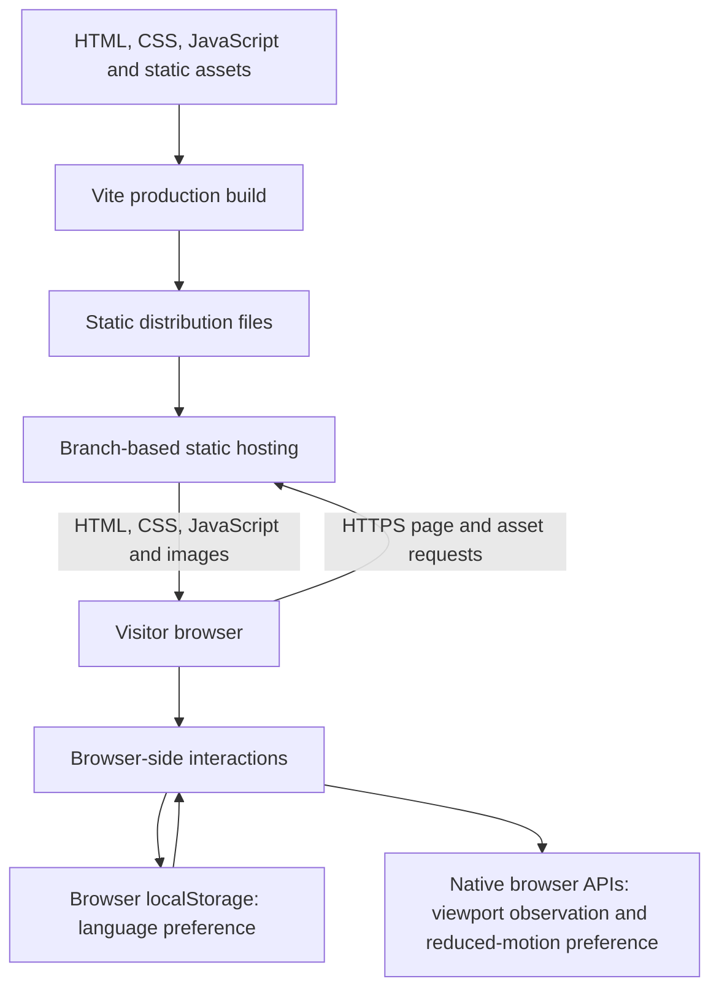

# Engineering Case Study: Static Media Product Experience

## 1. System Overview & Business Problem

This project is a lightweight, static product-information site for a mobile media application centered on playback across a user’s local network. It presents the application’s capabilities, usage flow, visual examples, and trust information without introducing a site-specific backend, database, or account system; the repository provides no evidence of traffic or deployment scale, so no scale claims are made here.

## 2. Infrastructure & Tech Stack

- **Backend:** None detected. The site is delivered as static HTML, CSS, JavaScript, and assets.
- **Frontend:** Vanilla JavaScript using native browser APIs; Vite for development and production builds; Tailwind CSS v4 with its Vite plugin for styling.
- **Database / caching:** No database or application cache detected. Browser `localStorage` persists the language choice.
- **Queues / workers:** None detected.
- **DevOps / testing:** npm scripts provide development, build, preview, and branch-based static publishing through `gh-pages`. No test framework, automated test scripts, container configuration, or CI workflow is present in the repository tree inspected.

## 3. Core Architectural Decisions

### 3.1 Static-first delivery

**Challenge:** A product-information experience needs to load and render without the operational cost and attack surface of a custom application server.

**Solution:** The page is authored as HTML and styled with CSS, with a small JavaScript entry point for interactive behavior. Vite compiles the assets into a static distribution; the configured base path supports publishing beneath a URL subpath.

**Technical Impact:** Runtime delivery does not require application APIs, server-side sessions, or a database. This keeps the deployment footprint small and reduces server-side failure modes, while limiting dynamic behavior to what the browser can provide.

### 3.2 Browser-native, minimal-persistence localization

**Challenge:** The page offers two languages and should select a sensible default while retaining an explicit visitor choice.

**Solution:** The client checks a saved language preference first, then falls back to the browser’s language. A centralized translation dictionary updates marked page elements, document language metadata, and the language controls; the preference is stored in `localStorage`.

**Technical Impact:** Localization requires no server round trip or third-party state service. It is straightforward to operate and extend, with the trade-off that persistence is scoped to the visitor’s browser and storage availability.

### 3.3 Progressive motion and visibility handling

**Challenge:** Scroll-based reveal effects should not make content inaccessible or dependent on motion support.

**Solution:** The client uses `IntersectionObserver` to reveal off-screen elements as needed, while immediately showing content when the API is unavailable or reduced motion is requested. CSS also provides reduced-motion and print overrides, and the document includes a no-script style fallback for reveal content.

**Technical Impact:** Animation is an enhancement rather than a prerequisite for reading the page. Unobserved elements are released after becoming visible, and visitors with motion preferences receive a simpler presentation.

### 3.4 Responsive navigation with explicit accessibility state

**Challenge:** A single page must support compact screens without losing navigation context or keyboard access.

**Solution:** The mobile menu is controlled by a small JavaScript toggle, exposes its expanded state through `aria-expanded`, associates the trigger with its panel, and closes when a navigation link is selected. The page also includes a skip-to-content link and labeled navigation regions.

**Technical Impact:** The interaction has a small client-side implementation and communicates state to assistive technology. Responsive layout and navigation are handled in the same static page rather than through a separate mobile application shell.

### 3.5 Static asset and subpath-aware build strategy

**Challenge:** A visual product page depends on large illustrative assets and must resolve resources correctly when deployed below a site root.

**Solution:** Vite’s base path is configured for subpath deployment. Images declare intrinsic dimensions; non-critical gallery images use lazy loading, while the lead visual is loaded eagerly. The deployment script builds before publishing the generated distribution directory.

**Technical Impact:** Explicit sizing helps reserve layout space, and lazy loading defers below-the-fold image transfers. The fixed base-path configuration simplifies a known deployment target, but needs to be updated if the site is moved to a different URL path.

## 4. System Architecture Diagram

## 5. Quality Assurance & Deployment

- **Testing:** The available package scripts define development, production build, and local preview commands. No unit, feature, or end-to-end test suite is declared in the inspected manifest or repository tree; therefore, automated behavioral coverage cannot be claimed.
- **Build and preview:** `npm run build` generates the production distribution, and `npm run preview` serves that build locally for inspection.
- **Deployment:** `npm run deploy` runs the build through its pre-deploy hook and publishes the generated distribution directory to a deployment branch using `gh-pages`.
- **Containers and CI:** No Dockerfile, compose configuration, or workflow configuration was found in the repository tree inspected. The documented deployment model is static branch publishing rather than a containerized service.

The implementation is intentionally a static client-side experience. That choice suits informational content and simple browser-local preferences, but server-dependent requirements—such as user accounts, centralized analytics, or remotely managed content—would require additional infrastructure not present in this codebase.
